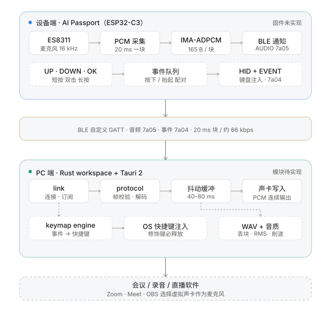

# 技术架构

## 总览



矢量图源文件见 [`architecture.svg`](architecture.svg)（随系统深浅色自适应）。下面是与图等价的
纯文本版，便于在终端和 diff 里对比：

```text
┌──────────────────────────── AI Passport / ESP32-C3 ────────────────────────────┐
│ ES8311 microphone                                                            │
│   │ I2S 16 kHz / 16-bit / mono                                               │
│   ▼                                                                          │
│ 320 samples ──► IMA-ADPCM ──► [seq][predictor][index][nibbles] ──► BLE notify │
│                                                                              │
│ UP / DOWN / OK ──► event queue ──► HID keyboard + custom GATT event           │
└──────────────────────────────────────────────────────────────────────────────┘
                                      │ BLE
                                      ▼
┌──────────────────────────────── PC ────────────────────────────────────────────┐
│ Rust device link ──► protocol / ADPCM decode ──► audio buffer                  │
│                                                   ├─► virtual audio device     │
│                                                   └─► WAV + quality metrics    │
│ keymap engine ──► OS shortcut injector                                         │
└──────────────────────────────────────────────────────────────────────────────┘
```

## 为什么第一版走自定义 GATT

既有参考实现已验证 BLE 自定义 GATT + IMA-ADPCM 能完成低延迟音频和 HID 按键（来源见 [REFERENCES](REFERENCES.md)）。第一版由 PC 软件把 PCM 写入虚拟声卡，会议软件把它当作普通麦克风。

**为什么不是"让系统直接认成蓝牙麦克风"**：这条路在这颗芯片上不存在，别白花时间。

| 方案 | 为什么不可行 / 代价 |
| --- | --- |
| HFP（免提协议） | HFP 是**经典蓝牙（BR/EDR）**的 profile。ESP32-C3 只有 BLE 射频，没有经典蓝牙 —— 不是"暂不做"，是芯片层面做不到 |
| LE Audio（LC3 / 单播） | 需要 Bluetooth **5.2+**，C3 是 5.0；且 macOS 对第三方 LE Audio 输入设备的开放度仍然很低（Apple 到 WWDC26 仍未支持 Auracast） |
| 自研 AudioServerPlugIn 驱动 | 技术上可行，但要 Apple 开发者账号签名 + 公证，驱动异常会拖垮整机音频，且成为长期维护项 |
| 换硬件（USB Audio Class） | 插线就不是"纯无线"了；要保住无线又走 HFP，得换成支持经典蓝牙的芯片 |

代价：用户需要安装虚拟声卡；PC 软件必须保持运行。这个取舍被明确接受为第一版方案。

## BLE 服务

- Service: `a7c52e00-31d4-4d2a-8f6b-5e9c1b3f7a00`
- CTRL: `...7a01`
- PROFILE: `...7a02`
- STATUS: `...7a03`
- EVENT: `...7a04`
- AUDIO: `...7a05`
- **Battery Service（标准）**: `0x180F` / Battery Level `0x2A19`（见下）

### 连接参数：8.25 KB/s 是链路契约的一部分

50 块/秒 × 165 字节 = **8.25 KB/s**。这个速率只在快速连接间隔下推得动，所以它跟帧格式
一样属于跨端契约，不是固件的实现细节：

- 设备广播里带 `0x0d`（从机首选连接间隔）= **15–30 ms**；建连后 600 ms 再主动发一次
  参数更新，被拒按 1 s 退避重试，最多 6 次；
- 运行中每次心跳检查实际间隔，**> 40 ms 就重新请求**（5 s 节流），并置 STATUS 的
  `LINK_SLOW` 位；
- 实测（macOS 15.3.1）：请求 15–30 ms 会被接受并落在 30 ms；请求 15–20 会被主机拒绝。
  这段历史见 [`GUI.md`](GUI.md) §14.8 与 [`KNOWN_ISSUES.md`](KNOWN_ISSUES.md) KI-005。

**为什么写进契约**：间隔一旦被主机放到 500 ms 量级，吞吐就掉到 ≈2 块/秒（每 500 ms
才送得出一块），块率随之坍塌 —— 而设备侧的采集与编码完全正常。这种会话产出的欠载、
漂移数字全是链路假象，不能当音质结论用。

### Battery Service（电量）

电量来自设备 I2C 总线上的 CW2017 电量计（0x63，与 ES8311 共总线），走 **蓝牙标准**
Battery Service，不占用自定义协议帧：

- 特征值 `0x2A19`（READ + NOTIFY）：1 字节 = 电量百分比（0..100），**裸值不套帧头**。
- 设备每 1 s 采样一次 SOC，只在数值变化时通知；连接后 PC 端主动读一次。
- **CW2017 没有内置电池模型，必须写入 80 字节 profile（BATINFO，`0x10–0x5F`）。**
  profile 缺失时芯片**不会报错**，只会把 SOC 停在 `0xFFxx`：本板实测 `0xFF00 / 0xFEE8`，
  而 VCELL 一直是正常的 3.9 V——KI-007 因此被误判成"电池坏了/芯片没醒"。
  固件开机读 BATINFO 与随固件的官方 UTL 520 mAh profile 逐字节比对，不一致才写：
  切 `CONFIG=0xF0`（sleep）→ 逐字节写 `0x10–0x5F` → 回读校验 → 置 `0x0B` 的 UPDATE 位（`0x80`）
  → `0x30 → 0x00` 重启让芯片重新加载并重算。校验不过**不置** UPDATE 位：
  宁可继续报"不可用"，也不要让芯片带着半份 profile 算出一个看似正常的错误百分比。
  **换电芯必须重新标定**，写错 profile 不会报错、只会给出错误的百分比。
  实现见 `device/main/battery.c` 的 `profile_matches` / `profile_install`。
- **0xFF / ATT 错误 = 电量不可用**（旧固件、电量计缺失，或芯片回报 SOC 无效），
  PC 端不得显示成 0%，**也不得静默隐藏**：GUI 顶栏显示「电量不可用」，
  靠 `AppEvent::Battery { pct: None }` 传递（`pct: Some(0..100)` 才是真百分比）。
  静默隐藏会让人以为这个功能没做——KI-007 现场就是这么误判的。
- **设备端在电量无效时返回 `0xFF`，不回 ATT 错误。** 规范上两种都算"不可用"，
  但 macOS 的 btleplug 遇到 ATT 错误时 `read()` 会永久挂起，PC 端若没给这一步设超时，
  整个连接流程会卡在「连接中」不动（KI-008）。PC 端仍需自带 2 s 超时兜底。
- 低电量阈值 20%（`device/main/battery.h` 的 `APM_BATTERY_LOW_SOC_PCT`）由设备端判定：
  GUI 状态栏高亮提示；设备端背光（GPIO21，LEDC PWM）做**被动查询式**指示——
  低电量时按任意键背光短闪 3 次，平时恒灭（零功耗）。不做常驻呼吸/闪烁：
  "没电了还持续点亮背光"与省电目标冲突，已明确否掉。
- 充电口旁的充电指示灯由充电 IC **硬件直驱**（充电时常亮、充满熄灭），MCU 未接线，
  固件不可控、不可变色；上游 BSP 能力契约也没有 LED 接口。
- 旧固件没有该服务时，PC 端静默降级：电量显示不出现，其余链路不受影响。

控制帧：

```text
[0x56 0x4D][version=1][type][len u16-LE][payload][CRC16-CCITT u16-LE]
```

音频块：

```text
[seq u16-LE][predictor i16-LE][index u8][IMA-ADPCM nibbles...]
```

20 ms @ 16 kHz = 320 个采样；ADPCM 为 160 字节，加 5 字节块头共 165 字节，约 66 kbps。

## 协议细节（实现契约）

下面这些是写代码时定下来的细节，`device/main/protocol.c` 与主机单测
`device/test/test_protocol.c` 都按它执行。要改先改这里，两端同步。

### CRC

- 算法：CRC-16/CCITT-FALSE（poly `0x1021`，init `0xFFFF`，不反转，xorout `0x0000`）。
- 覆盖范围：从 `version` 到 payload 最后一个字节，**不含**两字节 magic。
- 校验向量：`"123456789"` → `0x29B1`（单测里钉死）。

### 控制帧类型

| type | 方向 | 载荷 | 说明 |
| --- | --- | --- | --- |
| `0x01` START | PC → 设备 | 空 | 强制开始采集，不依赖 PTT |
| `0x02` STOP | PC → 设备 | 空 | 强制停止采集 |
| `0x03` SET_GAIN | PC → 设备 | `int8` dB | 麦克风 PGA 增益，0–42 |
| `0x04` PING | PC → 设备 | `seq u32-LE` | 延迟测量。设备必须原样回 PONG |
| `0x81` STATUS | 设备 → PC | 8 字节 | 1 s 心跳，也可直接读 STATUS 特征值 |
| `0x82` EVENT | 设备 → PC | `btn u8, ev u8, flags u8` | 按键事件 |
| `0x83` PONG | 设备 → PC | `seq u32-LE` | 回显 PING 的 4 字节；长度不是 4 的 PING 直接丢弃 |

PING/PONG 的三条硬约束：

- **PONG 走 EVENT 特征值**（与 `0x82` 共用通道），不新开特征值：它是控制面的回包，
  和音频流无关；新开一个特征值会改动 GATT 表，所有客户端都要重新发现服务。
  PC 端按 `frame.msg` 分派，不能按特征值猜类型。
- **回显而不是回填设备时间戳**：设备没有与主机同步的时钟，回填自己的 tick 只会引入
  "两个时钟怎么对齐"的新问题。PC 端用同一个单调时钟测一次往返，误差只有链路本身。
- **只回 4 字节**：设备不做长度透传，否则它可以被当成任意数据反射器用。

PING/PONG 测到的是**链路往返时延**（含两端协议栈、连接间隔、设备任务调度），
是音频单程时延的上界估计（≈ RTT/2），**不等于**端到端声学延迟 —— 后者还要经过
codec 采集、20 ms 分块、抖动缓冲、声卡播放。口径见 [`SOUND_QUALITY.md`](SOUND_QUALITY.md)。

STATUS 载荷：`state u8, flags u8, dropped u16-LE, sent u32-LE`。

- `state`：`0` IDLE / `1` READY / `2` CAPTURING / `3` ERROR
- `flags`：bit0 BLE 已连接、bit1 AUDIO 已订阅、bit2 PTT 按住、bit3 音频错误、
  **bit4 `LINK_SLOW`**（实际连接间隔 > 40 ms，链路撑不住 50 块/秒 —— 这种会话的
  欠载/漂移数字是链路假象，不能当音质结论用，见 [KI-005](KNOWN_ISSUES.md)）
- `dropped` / `sent` 是**本会话**计数（设备在每次 START 或 PTT 首次按下时归零），
  不是自设备启动起的累计值。


### 音频块

- 块头 5 字节：`seq u16-LE`、`predictor i16-LE`、`index u8`。
- nibble 打包：**低 4 位放偶数号采样**，高 4 位放奇数号采样。
- 块头里的 `predictor` / `index` 是**本块编码开始前**的状态。编码器跨块继承，
  解码器每块由块头重置 —— 因此丢一块不会污染后续音频，PC 端可以只靠 `seq`
  判断丢块，不必等链路恢复。
- 块长固定 165 字节，MTU 必须 ≥ 168；固件协商到 247 并把它作为发送前置条件。

### 按键事件

`ev`：`0` PRESS / `1` CLICK / `2` DOUBLE / `3` LONG / `4` RELEASE。

**键位映射只用 `PRESS`**（`keymap-3` 起，一个键一个动作）。`RELEASE` / `CLICK` /
`DOUBLE` / `LONG` 仍然照旧上报——这是跨端协议，改它要动帧格式、UUID 与共享向量，
收益只是省几帧通知——但 PC 端不再为它们提供映射项。

副作用要知道：**双击 = 两次 `PRESS`**，在 OK 的 toggle 语义下等于"开了又关"。
PC 端有切换窗口防抖（`apm_app::core` 的 `ptt_switching`）：开/关麦进行中（约几百毫秒）
再来的 PRESS 会被忽略，所以落在切换窗口内的双击只算一次动作；窗口外的双击仍是
一次正常的开+关。三键方案的语义代价还在，真要双击语义得单独加事件。
见 [`config/README.md`](../config/README.md)。

固件侧手势时序：去抖 20 ms、双击窗口 180 ms、长按 500 ms。
长按在按住满 500 ms 时**立即**上报，抬起后不再补发单击。

固件只走 GATT 事件路径，不额外发 BLE HID 报告 —— 映射表在 PC 端，固件再发一份 HID
就等于绕过它。取舍记录在 [`ROADMAP.md`](ROADMAP.md) 的 M1。

实现位置：`device/main/buttons.c`（判定）、`device/main/link.c`（EVENT 通知）、
`device/main/app_main.c`（PTT 与事件分发）。

## PC 端模块

模块划分是设计决定；名称按本项目的 `ai-passport-mic` 语义命名，不沿用参考实现的内部命名。

| 模块 | 职责 | 状态 |
| --- | --- | --- |
| `protocol` | 帧、载荷、ADPCM 编解码、按键映射 schema、WAV/音质指标 | 已实现 `desktop/crates/protocol`，含与 C 实现逐字节对拍的测试 |
| `link` | BLE 扫描/连接、特征值订阅 | 已实现 `desktop/crates/link`（btleplug），已在真机跑通（MTU 247） |
| `apmctl` | 扫描、状态、录音与音质分析命令行（验收工具） | 已实现 `scan` / `status` / `record` / `sink` / `probe` / `analyze` / `selftest` |
| 虚拟声卡输出 | 把解码后的 PCM 写进 BlackHole / VB-CABLE，带抖动缓冲 | 已实现 `desktop/crates/sink`（cpal 0.15，40–80 ms 自适应抖动缓冲）；已验证到会议软件端到端可用，回环探针受麦克风权限限制 |
| GUI 应用 | 设备状态、按键映射、虚拟声卡选择、实时电平与音质报告 | G0 已落地 `desktop/crates/gui`（Tauri 2 + Vue 3：骨架、蓝牙权限、设备扫描）；方案与后续分期见 [`GUI.md`](GUI.md) |
| `app` 内核 | 状态机、设备发现/连接编排、指标聚合、事件广播、诊断日志 | 部分实现 `desktop/crates/app`（`apm-app`，**不依赖任何 GUI 框架**）：`detect_adapter` / `scan` / `connect` 已在内核；`record` / `sink` 的编排仍在 `crates/cli/src/cmd.rs`，**待迁入**（[`GUI.md`](GUI.md) 决定 D1） |
| `firmware` | USB 设备枚举、版本比对、分段烧写、回读校验 | 已实现 `desktop/crates/app/src/firmware.rs`（用 `espflash` 4.7 作库，不调外部命令、不需要装 ESP-IDF）；单元测试覆盖镜像解析、分区表守卫、MD5 向量；**真机烧写 2026-11-06 已通**（检测 + 写入 + FlashMd5 校验），空片首烧仍未验。见「固件烧写与版本比对」 |

跨端一致性不靠"两份实现看起来一样"：`device/test/gen_vectors.c` 从 C 实现导出
`config/protocol-vectors.json`，Rust 的 `tests/c_vectors.rs` 读同一份文件逐字节比对
（CRC、帧、ADPCM 编码与跨块状态）。改了 `device/main/protocol.c` 必须重跑
`scripts/gen-protocol-vectors.sh`，否则对拍会用旧向量。

`device/main/protocol.c` 已按上面的契约实现了帧、CRC 与 ADPCM（编码 + 解码，解码用于主机
单测和后续 PC 端对照）。PC 端的 Rust 实现必须能通过同一组测试向量，否则两端不算对齐。

> 实现约束：桌面端**不要**引入语音识别、文字注入这类功能——它们不在第一版范围内
> （见 `docs/PRODUCT.md` 的非目标）。**固件烧写是例外**：它属于开箱流程，走 USB 而不走
> BLE，见下面的「固件烧写与版本比对」。

## 音频输出策略

目标不是让设备直接出现在系统麦克风列表，而是：

```text
AI Passport -> PC app -> BlackHole/VB-CABLE -> Zoom/Meet/OBS
```

这样第一版可以控制采样率、抖动缓冲和丢块策略，且不依赖系统蓝牙音频栈。

## 固件烧写与版本比对

裸片出货意味着 PC 软件要自己完成首烧（口径见 [`PRODUCT.md`](PRODUCT.md) 的「开箱体验」）。
这条路和 BLE 完全无关：它走 **USB**，用的是芯片 ROM 里固化的 bootloader，
设备哪怕一片空白也能烧。

### 为什么是 USB 而不是 BLE OTA

| 方案 | 结论 |
| --- | --- |
| USB（esptool 协议） | **采用**。ROM bootloader 在芯片内，空片可用；8 MB 镜像约 10–20 s |
| BLE 自定义 OTA | 不采用。前提是设备已有能跑起来的固件（裸片没有）；要双分区；分钟级；断连即失败 |
| 只做升级不做首烧 | 不成立。裸片没有任何固件，OTA 的前提不存在 |

### 硬件前提（不满足则整个体验假设作废）

- 板子的 USB 口必须接 ESP32-C3 的**原生 USB** D-/D+（GPIO18/19），不是外置串口芯片。
- 固件侧已开 `CONFIG_ESP_CONSOLE_USB_SERIAL_JTAG`（见 `device/sdkconfig`）。
- 设备枚举为 VID `0x303A` / PID `0x1001`。这是乐鑫 USB-Serial-JTAG 的标识，
  **不是** CH340（`0x1A86`）或 CP210x（`0x10C4`）。
- 免驱范围：macOS / Linux 原生 CDC-ACM；Windows 10+ 走系统自带 usbser；Windows 7 不支持。
- 烧写不需要按 BOOT：esptool 通过 USB 控制线（DTR/RTS 序列）软复位进下载模式。
  **但这是"通常成立"，不是"物理保证"**——固件把 USB 外设配置乱掉时可能需要手动复位。

### flash 布局与「NVS 不能碰」

| 区域 | 偏移 | 烧写时 |
| --- | --- | --- |
| bootloader | `0x0` | 写 |
| 分区表 | `0x8000` | 写 |
| **nvs（用户配置）** | `0x9000` | **跳过** |
| phy_init（RF 校准） | `0xF000` | **跳过** |
| factory app | `0x10000` | 写 |

**这一条最容易做错。** `idf.py merge-bin` 产出的是从 `0x0` 到 app 末尾的**连续**镜像，
空隙用 `0xFF` 填满。如果拿它从 `0x0` 整段写下去，`0x9000` 的 NVS 与 `0xF000` 的 phy_init
会一起被填成 `0xFF`——用户每插一次设备就丢一次按键映射和蓝牙配对；phy_init 被抹掉后
射频还要重新校准。表现是"插上 USB 就掉配对"，很容易被误判成蓝牙问题。

所以烧写必须**切片**，中间那段一个字都不写：

```text
[0x0000, 0x8000)  → 写到 0x0000    bootloader + 填充
[0x8000, 0x9000)  → 写到 0x8000    分区表 + 填充
[0x9000, 0x10000)                  不写（nvs + phy_init）
[0x10000, EOF)    → 写到 0x10000   app
```

切之前先读镜像 `0x8000` 处的分区表（32 字节一条，magic `0x50AA`，在镜像里按小端存成
`AA 50` 两个字节）核一遍：确实是 `nvs@0x9000` + `factory@0x10000` 才按上面的常量切；
对不上就拒绝烧写。

### 一次会话写完三段，校验要另开一次

两条实现约束，改了就会坏（2026-11-06 真机撞出来的，记在这里防回退）：

1. **三段必须一次 `write_bins_to_flash` 写完。** 它的收尾是 `finish(reboot = true)`，
   每调用一次就复位一次设备；分三次调等于写完 bootloader 就让芯片跑起来，
   第二段的 SPI attach 必然超时。
2. **写完之后的校验必须重开一次连接。** 第一段会话结束时设备已经在跑应用，
   旧连接上发 `FlashMd5` 没人应答（真机报 `Timeout while running FlashMd5 command`）。
   重连会把它拉回下载模式，校验完再复位回应用模式。
3. **退出时一定要复位。** espflash 的 `Flasher` 没有 `Drop`，进了下载模式没人负责退出；
   读失败/写失败/提前 return 都要把设备放回应用模式，否则用户看到的是"设备不见了"。
   实现里用 `ResetGuard` 兜住。

### 串口枚举：一台设备只能出现一次

macOS 上 `serialport::available_ports()` 会把同一个 USB 串口的 callout（`/dev/cu.*`）
和 dialin（`/dev/tty.*`）各返回一条。不去重的话，界面就会"插了一台设备、列表里两台"，
而且拿 dialin 那条去连必然失败（它等载波，不是给 esptool 用的）。
`firmware::list_ports()` 按 VID/PID + 序列号去重并优先保留 `cu`。
**不要**在分区表变了之后还按旧常量硬切。

**本机实测（2026-11-06，`device/build/ai-passport-mic-merged.bin`）**：镜像总长
`0xAEB60`，`0x9000`–`0xFFFF` 整段是 `0xFF` 填充（nvs 与 phy_init 的位置）。
"整段写会清配置"不是理论风险，是每次都会发生。

### 版本比对（不改协议、不要求设备有固件）

- 每个 app 镜像在**镜像内偏移 `0x20`** 处有 `esp_app_desc_t`，magic `0xABCD5432`
  （小端字节序 `32 54 CD AB`）。
- `version[32]` 在描述符内偏移 `0x10`，即 **flash 绝对地址 `0x10030`**
  （`0x10000` app 分区 + `0x20` 描述符 + `0x10` 版本字段）。
- 读设备这 32 字节，与随包镜像同位置比对，就能判断"要不要烧"。
  **不需要**新增 BLE 命令，也不需要设备能跑起来。
- 读设备**必须走 `read_flash`（stub 路径）**，不能用 `read_flash_rom`：
  后者是 ROM 专用命令，stub 起来之后直接被拒（真机报 `The bootloader returned an error`）。
- 读不到、全 `0xFF`、magic 不对 → 按"空片或未知"处理，转烧写。

前提是 `version` 必须可比较。ESP-IDF 默认用 `git describe` 填这个字段，当前产物是
`7552506-dirty`——带 git hash 和 `-dirty`（说明构建时工作区有未提交改动），既不能对外
显示，也没法做版本序比较。**必须固定成 semver**（`device/CMakeLists.txt` 的
`PROJECT_VER`）。

**本机实测（2026-11-06，固定 `PROJECT_VER=0.1.0` 后重建）**：

| 检查项 | 结果 |
| --- | --- |
| `merged[0x10020..0x10024]` | `32 54 CD AB`（magic 正确） |
| `merged[0x10030..0x10050]` | `0.1.0` |
| `merged[0x10000..]` 与单独构建的 `ai-passport-mic.bin` | 逐字节相同（650080 字节） |

也就是说**版本字段和 app 段都能纯离线从镜像里读出来**，不需要连设备。

### 烧写后的校验

写完必须**校验 app 分区的实际内容**，不能信任写操作的应答：供电不稳、劣质线材、
无源 HUB 分线都可能静默丢字节，而 esptool 的应答早就返回了。

实现用 esptool 的 `FlashMd5`：让设备自己算 app 分区的 MD5，与本地对同一段数据算的
MD5 比对。不用"整段回读再算"是因为回读 650 KB 要十几秒，而 `FlashMd5` 只要一条命令——
要验的不是"能不能读"，是"写进去的对不对"。

校验不通过就报"未完成"，不允许报"已完成"让用户接着去连蓝牙。

**真机验证（2026-11-06，ESP32-C3 实板）**：`apmctl firmware probe` 读出设备
`0.1.0`、`apmctl firmware flash` 三段写入 5.0 s、FlashMd5 一致，写完后设备自行
复位回应用模式并恢复 BLE 广播。

### 失败与恢复

- 烧写中途断线/断电：设备回到 ROM 下载模式，重插可继续。**不做一次性状态**，
  也不要把"失败"写成终态。
- 校验失败：明确提示重试，并保留设备仍在下载模式这一事实（用户不用拔插）。
- **不提供 chip erase 入口**：整片擦除会连 NVS 与 RF 校准一起清掉，那是维修动作，
  不是开箱动作。要清用户配置必须是独立的、用户显式点的"恢复出厂设置"。

### 与 GUI 的关系

烧写逻辑放 `apm-app::firmware`（无 UI，CLI 也能用），GUI 只负责显示状态、进度、结果。
按 [`GUI.md`](GUI.md) 的决定 D1，不允许在 `crates/gui` 里再写一套。

## 分发与安装成本

**用户必须自己装一个虚拟声卡**，这是第一版绕不开的成本：

| 平台 | 要装什么 | 之后怎么用 |
| --- | --- | --- |
| macOS | BlackHole 2ch（免费，GPL-3.0） | 本程序写到 `BlackHole 2ch` 的**输出**；会议软件的麦克风选 `BlackHole 2ch` 的**输入** |
| Windows | VB-CABLE（免费） | 同上，名字是 `CABLE Input` / `CABLE Output` |

许可证上必须清楚的一点：

- BlackHole 是 **GPL-3.0**。没有商业例外，**不能**把它的二进制塞进闭源安装包里分发；
  要随包分发就得找 Existential Audio 买商业许可。
- "让用户自己去官网或 `brew install blackhole-2ch` 安装"不涉及分发，完全没问题 ——
  它保持独立软件的身份。

所以第一版对外分发时，安装器能做的只有三件事：检测缺失、给下载指引、装完后一键验证
路由是否打通。**不要**替用户静默安装。

要彻底去掉这个依赖，只有两条路，代价都在别处：自研 AudioServerPlugIn 驱动
（签名 + 公证 + 系统级故障风险 + 长期维护），或改硬件形态（USB 麦克风 / 换支持经典
蓝牙的芯片）。M5 之前不要悄悄改这个取舍。

## 延迟预算

| 环节 | 目标 |
| --- | --- |
| 设备采集 + 编码块 | 20 ms |
| BLE 连接间隔与通知 | 15–30 ms |
| PC 抖动缓冲 | 40–80 ms |
| 虚拟声卡缓冲 | 10–40 ms |
| 稳态合计 | p95 ≤ 150 ms |
| OK 按下到首块音频 | p95 ≤ 250 ms |

这些是验收目标，不是当前实测值。必须在真实设备、目标主机和虚拟声卡组合上测量。

## 可靠性约束

- 音频块按序号检测丢失和乱序；报告记录丢块数，不用“音频能播”掩盖链路质量。
- 设备断连后 PC 端必须停止向虚拟声卡写入旧缓冲，避免会议软件持续收到静音伪装成在线。
- 设备与声卡各有一颗晶振，"16 kHz" 不是同一个数（实测 20 s 差约 84 ms）。PC 端必须做
  长期漂移补偿：按缓冲区存量趋势做单样本插删（上限 1%），**不允许**靠周期性欠载或整帧
  丢弃兜底。实现见 `desktop/crates/sink/src/playout.rs`。
- 采集端偶发满量程逐样本变号的瞬态读出，两端各拦一次：固件编码前压成静音（
  `apm_pcm_is_corrupt`），PC 端解码后再兜一层（`apm_protocol::glitch`）。判据与口径见
  [`SOUND_QUALITY.md`](SOUND_QUALITY.md) 的「毛刺」。
- 快捷键注入必须使用按下/抬起配对，异常路径要释放 Ctrl / Alt / Shift / Win。
- 修改设备名时保留旧蓝牙名别名，避免已配对设备因名称缓存失效。
- 固件构建与真机验证分开报告；没有硬件证据不得宣称通过。
